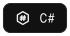
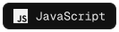
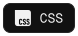
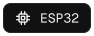
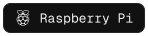

 

<!-- catalog:start -->

 

 

 

 

 

 

<!-- catalog:end -->

 
Where software meets hardware &nbsp;·&nbsp; Linux internals &nbsp;·&nbsp; Devices that talk to each other &nbsp;·&nbsp; Security, the ethical way

Michael Jesús Ticona &nbsp;·&nbsp; <a href="mailto:ticona1009@gmail.com">ticona1009@gmail.com</a> &nbsp;·&nbsp; <a href="https://github.com/michael-ticona-dev">github.com/michael-ticona-dev</a>
